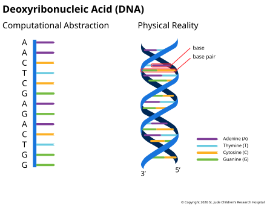

## Introduction

**Cells** are the smallest unit of life and are the building blocks of organisms, from a
single-celled bacterium to the [trillions of cells that make up the human
body](https://journals.plos.org/plosbiology/article?id=10.1371/journal.pbio.1002533).
Cells are complicated organized structures that take a variety of forms, forming tissues
and organs and completing the body's functions.

Within nearly every cell is a **genome**. A genome is the complete inherited instruction
set for producing, operating and maintaining a living cell or organism. This information
is physically encoded in a molecule called deoxyribonucleic acid or **DNA**. Among other
things, DNA contains instructions for the assembly of tens of thousands of different
molecular products. These instructions (or recipes) are called **genes**, and the
physical, molecular products genes encode are called **proteins**. Cells are constantly
reading and interpreting genes stored within the DNA in order to assemble various
proteins. Each cell type in the body produces a complex ecosystem of proteins that keep
the cell alive and executing its specific function.

### Bakery Analogy

To illustrate this phenomenon, imagine the cell as a bakery that makes many different
types of cakes. In this analogy, the genome stored within the DNA is the master recipe
book containing more than 20,000 different cake recipes (genes). The physical cakes that
are made from these recipes are the proteins. Notably, there are a limited number of
copies of the recipe/gene (two copies in the normal case for humans), but you may make
thousands or more physical cakes from those recipes. Depending on the type of cell, the
mixture of different cake flavors, their quantities, and how they interact together will
be different.

:::tip
Keep an eye on this analogy—we will refer back to and build upon it a number of times
during the course of this guide.
:::

## A Mental Model for DNA 

Conceptually, you can think of DNA laid end-to-end as a ~3 billion character long string
consisting only of 'A's, 'C's, 'G's and 'T's. This string and any substring contained
within are commonly referred to as genomic **sequences**. These characters represent the
physical Adenine, Cytosine, Guanine, and Thymine **bases** (or **nucleotides**)
respectively.

Importantly, though it's easy to conceptualize DNA as a single, very long string, the
reality is more complex. DNA is composed of two complementary sequences known
as **strands**. Each base is actually a member of a **base pair**, whereby nucleotides
complement each other uniquely—'A's pair only with 'T's, and 'G's only with 'C's. Up
close, this structure resembles a spiral staircase as seen in the figure below.

When cells divide, the helix unwinds and the base pairs separate into two strands, each
serving as a template for a new copy of the original DNA. Normal healthy cells then copy
the genetic code very accurately, rarely introducing variation.

## How DNA Is Packaged

In plants, animals and other eukaryotes, DNA is broken up into a number of large
sequences called **chromosomes** that are tucked into the nucleus. Chromosomes typically
come in pairs, one from your father and one from your mother. For humans, there are
normally 22 pairs of **autosomes** (chromosomes shared by both sexes) and a pair of sex
chromosomes (XX for females or XY for males), totaling 23 pairs of chromosomes.
Autosomes are numbered from 1 to 22 roughly by size, from largest to smallest. The full
set of chromosomes makes up the genome.

Inside the nucleus, each chromosome's DNA is wrapped around proteins called
**histones**. Together, DNA and the histones it wraps around form **chromatin**. Tightly
packed chromatin keeps the long DNA string compact, while loosely packed chromatin
leaves genes accessible, which helps control which gene products are made in a given
cell.

![Zoom sequence from a cell to its nucleus, to one chromosome, and then to the chromatin fiber. Inside the nucleus, each chromosome fills its own territory. Every territory mixes open and dense chromatin, with dense chromatin along the nuclear edge and around the nucleolus, and more open chromatin toward the center. One chromosome is enlarged to show a single tangled thread, with loops of open chromatin and clumps of dense chromatin, packed most tightly where it meets the nuclear edge. The close-up shows DNA wrapped around histones: a tightly packed zigzag that is less accessible, and a loosely packed stretch that is more accessible, where bare DNA at a promoter sits just before a gene that still carries histones.](../images/1.3-chromatin.svg "Inside the nucleus, each chromosome is a loose, tangled thread that fills its own territory, with denser chromatin toward the edge and more open chromatin toward the center. Chromosomes only condense into the familiar X shape when a cell divides.")

## Conclusion

The genome is a vast search space for biological questions. It holds the instructions
every cell draws on, so studying it helps explain how our bodies work. Genomes account
for the natural differences between individuals, define family traits, and distinguish
how cells in tissues and organs vary. When genomes acquire adverse mutation(s), cancer
as well as other genetic diseases can occur. By examining the relationship between
physical traits (e.g. blood pressure or the development of a tumor) and the genome,
known as **genotype-phenotype relationships**, researchers can learn how a person's
genetic makeup shapes their health.
