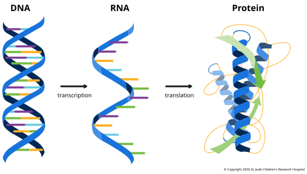

## Introduction

Most genomics analyses rest on one idea from molecular biology: the **central dogma**.
Genetic information flows from DNA to RNA to protein. The figure below gives a
simplified overview; the [Wikipedia
page](https://en.wikipedia.org/wiki/Central_dogma_of_molecular_biology) covers it in
much more detail.

## From DNA to Protein

The central dogma describes how the information in a gene becomes a working protein. In
cells like ours, it happens in two main steps:

1.  **Transcription.** Inside the nucleus, an enzyme called **RNA polymerase** reads one
   gene and builds a matching strand of ribonucleic acid (**RNA**). This RNA is a
   temporary working copy of the gene, called a **transcript**. Before it leaves the
   nucleus, the transcript is edited into **messenger RNA** (**mRNA**): unneeded pieces
   are cut out, and protective ends are added. The DNA itself never leaves the nucleus.
   [Transcription](03-transcription.md) covers this step in detail.

2.  **Translation.** Outside the nucleus, molecular machines called **ribosomes** read
   the mRNA three letters at a time. Each three-letter block, called a **codon**, stands
   for one amino acid. The ribosome links the amino acids into a chain, which folds into
   a protein. [Translation](04-translation.md) covers this step in detail.

:::info Information can flow backward

Some viruses, including HIV, carry an enzyme called **reverse transcriptase** that
copies RNA back into DNA, a process called **reverse transcription**. Labs use the same
enzyme for RNA sequencing: most sequencers read only DNA, so the RNA is copied into DNA
first. What the central dogma does rule out is information flowing back out of a
protein. A protein's sequence is never copied into RNA or DNA.

:::

A few consequences of this process come up throughout genomics:

- **One gene, many copies.** A cell has only two copies of most genes, one inherited
  from each parent, but it can transcribe a gene into many RNA copies, and each RNA can
  be translated many times. RNA copies break down after a while, so a cell must keep
  transcribing a gene to keep making its protein. How much a cell transcribes each gene
  is called **gene expression**. It is a big part of why a skin cell and a nerve cell
  behave differently even though they carry the same DNA.
- **Not every RNA becomes a protein.** Some RNAs, such as the ribosomal and transfer
  RNAs that carry out translation, do their jobs as RNA. Many others help control which
  genes are used and how much, but what most of them do is still being worked out. These
  **noncoding RNAs** are covered in [Noncoding
  RNAs](../07-advanced-topics/non-coding-rnas.md) under Advanced Topics.
- **Mistakes in DNA last.** Transcription and translation occasionally make errors, but
  these are short-lived because the faulty RNA or protein is soon replaced. A change in
  the DNA itself, called a **mutation**, is copied into every RNA made from that gene
  and passed on whenever the cell divides. This is why mutations can cause lasting harm,
  including disease, and why genomics focuses on finding them.

## The Bakery Revisited

The bakery from the previous page fits this process closely. The master recipe book
(DNA) stays locked away in the back office (the nucleus), and each recipe in it (a gene)
can be copied but never taken out. When the bakery needs a cake, a staff member (RNA
polymerase) copies one recipe onto an index card (mRNA). The card is carried out to the
baking floor, where bakers (ribosomes) follow it to make cakes (proteins).

Bakers use the same card again and again until it wears out. The number of cards on the
baking floor varies from recipe to recipe: a popular cake may have dozens of cards in
use, while a rarely made one may have only one, or none at all. The number of cakes
varies too, and in general, recipes with more cards produce more cakes.

That isn't strictly true, though. Some cards are used constantly while others are mostly
set aside, and some cakes go stale within hours while others keep for days. Cells work
the same way. Genes with more mRNA tend to make more protein, but not always, so
measuring gene expression gives a useful but rough guide to how much of a protein a cell
has.

A typo on one card spoils a few cakes, but a typo in the master book (a mutation) ends
up on every card copied from it.
