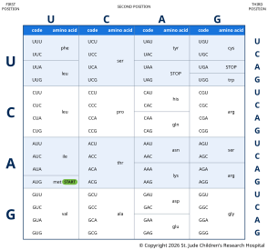

## Decoding the Transcript

After DNA is transcribed to RNA and the RNA is spliced, the next step in protein
production is translation. The **genetic code** that cells use to translate RNA to
protein is nearly universal. You, your dog, and the lettuce in your salad all read it
the same way; only mitochondria and a few microbes use slight variants. Because of this,
a human gene placed in bacteria still produces the human protein, which is how insulin
for diabetes is made. A shared code, together with the many genes humans share with
other animals, is also why studying a gene in mice can tell us about the same gene in
people.

 at a time, and each codon adds one amino acid to the growing protein.")

The mRNA transcript is encoded in three-letter nucleotide blocks known as codons. Codons
specify that a particular protein building block, or **amino acid**, should be added to
a growing protein chain. For example, the mRNA sequence above has "CCU" in the second
codon position. This codon instructs the protein assembling machinery of the cell to add
a proline to the amino acid sequence at position two.

A ribosome moves along the mRNA one codon at a time, from the 5′ end toward the 3′ end.
For each codon, a small adapter molecule called a **transfer RNA (tRNA)** brings in the
matching amino acid: one end of the tRNA carries the amino acid, and the other end has
three bases, called an **anticodon**, that pair with the codon. The ribosome joins each
new amino acid to the growing chain until it reaches a **stop codon**, then releases the
finished protein.

![An mRNA strand runs left to right from its 5′ cap to its 3′ end, written as codons AUG CCU GAG CCA AGG CUU GAA AAC GCC GGU. A ribosome, made of a large subunit above the mRNA and a small one below, sits over GAG, CCA and AGG. Inside, a tRNA with anticodon GGU pairs with CCA and holds the growing protein chain, beads M, P, E and P, which runs out the top of the ribosome. Next to it, a tRNA with anticodon UCC pairs with AGG and carries a single R bead. A faded, empty tRNA with anticodon CUC tilts away at the left. To the right, a free tRNA with anticodon GAA and an L bead drifts toward the ribosome, ready for the next codon, CUU. An arrow notes that the ribosome moves 5′ to 3′, one codon at a time.](../images/1.8-ribosome.svg "Translation by the ribosome. The ribosome reads the mRNA one codon at a time. Each tRNA's anticodon pairs with a matching codon and brings the corresponding amino acid, which is added to the growing protein chain.")

As shown in the amino acid lookup table below, other codons specify that translation
should start or stop at a particular position. Because multiple codons translate to the
same amino acid, some changes to the nucleotide sequence may not change which amino acid
is added to the growing protein chain (e.g., if your triplet starts with "CG", the amino
acid is always an arginine and the third nucleotide doesn't matter).

A change that alters the mRNA sequence but not the resulting protein is called a
**synonymous variant**, often called a "silent mutation". Synonymous variants are
usually harmless, though occasionally they affect splicing or how quickly a protein is
made. Other changes can affect the final protein in ways ranging from insignificant to
harmful. Knowledge of the codons and the chemistry of proteins is used to predict the
effect of a given variant on the resulting protein.

## Reading Frames

Whenever you decode one alphabet into another, accuracy depends on starting in the right
place. Any stretch of mRNA can be split into codons in three different ways, called
**reading frames**, depending on whether you start at the first, second or third
nucleotide, and each frame spells out a completely different string of amino acids. The
ribosome sets the frame by scanning along the mRNA from the 5′ cap until it finds a
**start codon**, AUG (which codes for methionine), usually the first one it meets. From
there it reads three bases at a time.

![The mRNA sequence AUG CCU GAG CCA AGG CUU GAA AAC GCC GGU, followed by an extra A, with a START marker at AUG. Original: the codons are read as Met, Pro, Glu, Pro, Arg, Leu, Glu, Asn, Ala, Gly, giving the protein M P E P R L E N A G. One base deleted: the C at position 4 is crossed out. AUG still codes Met, but every codon after the deletion is read one base later: CUG, AGC, CAA, GGC, UUG, AAA, ACG, CCG, GUA. They code Leu, Ser, Gln, Gly, Leu, Lys, Thr, Pro, Val, giving the protein M L S Q G L K T P V. Only the first amino acid matches the original.](../images/1.10-reading-frames.svg "A frameshift. Deleting a single base just after the start codon leaves the first codon unchanged but shifts the reading frame of every codon after it, so the rest of the protein is completely different.")

Consider the sequence in the figure above (a contrived example, but useful for our
illustration here). Read from its start codon, it gives methionine, proline, glutamic
acid and so on. Now suppose a single nucleotide, the C just after the start codon, is
deleted. The ribosome still starts at AUG, but every codon after the deletion is read
one position further along: "CUG" (leucine) instead of "CCU" (proline), and a completely
different protein is made from that point on.

An **open reading frame** (ORF) begins with a start codon and runs to a stop codon, with
no other stop codon in between. This is the stretch that is translated into a protein.
Changes that create or remove a start or stop codon, or that shift the reading frame,
can dramatically alter the protein. An **insertion** or **deletion** whose length is not
a multiple of three shifts every codon after it, as in the example above; this is called
a **frameshift** mutation.

## Bakery Analogy

On the baking floor, the baker (a ribosome) reads the index card (mRNA) in three-letter
words (codons). The baker starts at the word that marks the beginning of the recipe (the
start codon) and stops at the word that marks its end (a stop codon). For each word, a
kitchen assistant (a tRNA) brings the matching ingredient (an amino acid) from the
pantry. A typo that turns one word into another word for the same ingredient makes no
difference to the cake (a synonymous variant). But if a letter is dropped, every word
after it is misread (a frameshift), and the cake comes out completely different.
