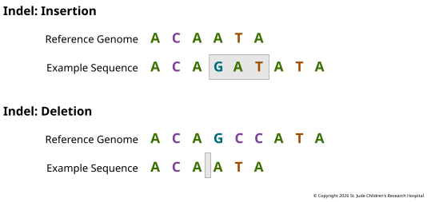

An **insertion** adds one or more bases to a sequence, and a **deletion** removes them.
Together they're called **indels**. A single base is the most common size, and anything
up to about 50 bases usually counts as an indel; many tools call larger events
[structural variants](04-structural-variation.md), though the cutoff varies from tool to
tool. Compared with the reference, a typical person carries somewhere between 550,000
and 625,000 indels, [about one for every six or seven SNVs][1000g].

Insertions and deletions are usually discussed together because they behave so much
alike. They arise from the same kinds of copying and repair errors, they disrupt genes
in the same ways, and the same problems make both hard to find. Their labels are also
relative. An insertion simply means the sample has bases that the reference lacks.
Because the reference is one genome among many, those bases may have been lost from the
reference's ancestors rather than gained in the sample's.

## Indels in Genes

Inside a gene's coding sequence, the first thing to check about an indel is its length.
The ribosome reads three bases at a time (see [Reading
Frames](../01-biological-foundations/04-translation.md#reading-frames)), so an indel
whose length is a multiple of three is **in-frame**: it adds or removes whole amino
acids and leaves the rest of the protein as it was. Both examples in Figure 3.5 are
three bases long, so both are in-frame. Any other length causes a frameshift. The amino
acids after the indel are wrong, and a stop codon usually turns up soon, cutting the
protein short. Length only sets the scale of the change, though. What the change does
depends on which part of the protein it hits, so a single missing amino acid can be
devastating, and a frameshift doesn't always just break a gene:

- *CFTR* F508del, [the most common cause of cystic fibrosis][kerem], is an in-frame
  deletion of three bases. It removes a single amino acid, phenylalanine 508, and that's
  enough to make the protein misfold (see [Figure
  1.11](../01-biological-foundations/05-protein-folding-and-modification.md#figure-1-11)).
- *BRCA1* 185delAG deletes two bases near the start of the gene, shifting the frame and
  stopping the protein early. [About 1 in 100 Ashkenazi Jewish people][struewing] carry
  it, and it raises the risk of breast and ovarian cancer.
- *NPM1* gains a four-base insertion near the end of the gene in [about a third of adult
  acute myeloid leukemias][falini]. It's a somatic frameshift, but rather than
  destroying the protein, it gives it a new tail that sends it out of the nucleus and
  into the cytoplasm, and the misplaced protein helps drive the leukemia.

Outside coding sequence, most indels have no noticeable effect. Some do: an indel at a
splice site can change how a transcript is spliced, and one in a promoter or enhancer
can change how much of a gene is made.

## Where Indels Happen

Indels cluster in repetitive sequence. When a cell copies a run of one base, such as
AAAAAAAA, or a short repeated unit, such as CACACACA, the new strand can slip out of
register and gain or lose a unit. Short repeats like these are called
**microsatellites**, and they're among the most variable places in the genome. The
cell's **mismatch repair** system fixes most of these slips. Tumors that have lost it,
through an inherited defect (as in Lynch syndrome) or a somatic one, pile up indels at
microsatellites across the genome. This is called **microsatellite instability** (MSI).
It's common in colorectal and endometrial cancers, and it leaves its own indel
signatures, catalogued alongside the [SNV
signatures](02-single-nucleotide-variation.md#where-somatic-snvs-come-from).

MSI has also been studied in cancer treatment. All those frameshifts make abnormal
proteins that the immune system can recognize. Immune cells carry a brake, a protein
called PD-1, and in a trial, [many MSI tumors responded][le] to drugs that block it and
let the immune cells attack. In 2017, one of these drugs became [the first cancer drug
approved in the US][lemery] on the strength of a genetic feature, MSI, whatever part of
the body the tumor started in.

## Describing and Finding Indels

In a VCF file, an indel is written with one extra base: the base just before it, which
the reference and the sample share. The insertion in Figure 3.5 becomes REF `A`, ALT
`AGAT`, and the deletion becomes REF `AGCC`, ALT `A`. Without that anchor, one side
would be empty.

Repeats make an indel's position ambiguous. Delete one CA from TCACACAG and you get
TCACAG, but nothing says which of the three CAs went missing. Two tools can report the
same deletion at different positions, so indels are usually **left-aligned**, shifted as
far left as they'll go, before they're compared. [Variant
Equivalence](06-variant-equivalence.md) returns to this problem.

Indels are also harder to find than SNVs. Aligners count a gap as costlier than a
mismatch, so an indel near the end of a read is often aligned as a few mismatched bases
instead. Callers such as GATK's `HaplotypeCaller` work around this by reassembling the
reads in each suspicious region before deciding. Runs of a single base cause their own
trouble, because sequencing and PCR both tend to add or drop a base there, and the error
looks just like a real indel. And a read only shows an indel it spans, so the longer the
insertion, the fewer reads capture it whole.

[1000g]: https://doi.org/10.1038/nature15393
[kerem]: https://doi.org/10.1126/science.2570460
[struewing]: https://doi.org/10.1038/ng1095-198
[falini]: https://doi.org/10.1038/s41375-022-01666-2
[le]: https://doi.org/10.1056/NEJMoa1500596
[lemery]: https://doi.org/10.1056/NEJMp1709968
