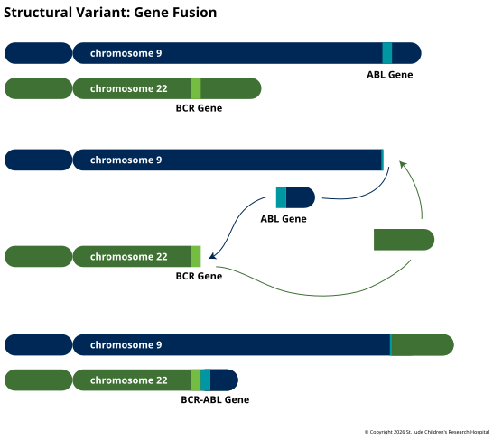

**Structural variants** (SVs) change larger pieces of the genome. A segment can be lost,
copied, flipped, moved somewhere else or swapped between chromosomes. They start where
indels stop, at about 50 bases (again, the cutoff varies from tool to tool), and the
largest span millions of bases and can be seen under a microscope. The 1000 Genomes
Project found [2,100 to 2,500 SVs in a typical genome][1000g], covering about 20 million
bases. That's far fewer variants than SNVs or indels, but more bases changed. Long-read
sequencing finds many more, [about 27,600 per genome][chaisson], mostly smaller ones in
repetitive sequence that short reads miss.

## Breakpoints and Junctions

However complicated an SV looks, it comes from the same few steps: the DNA breaks, and
the loose ends are joined back together in a new order. The places where the sample
stops matching the reference are the **breakpoints**. Each new join is a **junction**,
connecting two stretches of the reference that aren't normally next to each other. A
junction has a direction. It can carry on reading the same way, or it can fold back and
continue on the opposite strand, as the [reverse
complement](../07-advanced-topics/dna-structure.md). A few extra bases that come from
neither side are sometimes stitched in at a junction, too.

Any SV can be described as a list of its junctions, and the pattern of junctions tells
you what kind of SV it is. One more distinction helps. A **balanced** SV moves sequence
around without gaining or losing any, so every base is still there, just in a different
order. An **unbalanced** SV adds or removes sequence, which changes how many copies of
it the cell has (see [Copy Number Variation](05-copy-number-variation.md)).

## Kinds of Structural Variants

![Seven pairs of rows, each comparing a reference sequence of colored, lettered segments with a sample. Deletion: A B C D E becomes A B D E, with C lost. Insertion: a new segment X appears between B and C. Tandem duplication: C appears twice in a row. Inversion: C stays in place but points the other way, with a junction on each side. Translocation: two chromosomes, A B C D E and V W X Y Z, swap ends to give A B C Y Z and V W X D E; a third line shows the moved piece arriving reversed. Single breakend: A B C joins a hatched block of sequence that cannot be placed in the reference. Complex: segments A to G are reassembled as A, reversed E, C, F, reversed B, G, with D lost and a junction between every pair. Red marks show each junction.](../images/3.6-structural-variant-types.svg "Kinds of structural variants. Each row shows the reference (top) and a sample (bottom); red marks are junctions, where two pieces of DNA that are not neighbors in the reference are joined. A deletion, insertion or tandem duplication changes how much DNA there is. An inversion or translocation rearranges it without gaining or losing any. A single breakend can be placed on only one side, and a complex rearrangement such as chromothripsis shatters a region and rejoins the pieces at many junctions.")

- **Deletion.** A segment is lost and the sequence on either side is joined. It takes
  one junction, and it's unbalanced.
- **Insertion.** New sequence appears at a single point. Many large insertions are
  **mobile elements**, stretches of DNA that copy themselves into new places in the
  genome. Compared with the reference, a typical person carries [about 915 Alu and 128
  L1 insertions][1000g], the two most common kinds.
- **Tandem duplication.** A segment is copied, and the copy lands right after the
  original. It takes one junction, and it's unbalanced: the segment now has an extra
  copy.
- **Inversion.** A segment is cut out, flipped end to end and put back in the same
  place. Both of its junctions fold back. Nothing is gained or lost, so it's balanced.
- **Translocation.** A segment moves to a new place. Most often it moves to a different
  chromosome, but it can also move within the same one, which takes three junctions. The
  moved segment can keep its direction or arrive inverted. When two chromosomes trade
  pieces and nothing is lost, the translocation is balanced.
- **Single breakend.** Only one side of a junction can be placed. One end sits in the
  reference, and the other runs into sequence that can't be mapped, such as a long
  repeat or DNA missing from the reference altogether.
- **Complex.** Some events have several junctions that fit none of these patterns. The
  most extreme is **chromothripsis**, in which one or a few chromosomes shatter and are
  stitched back together in a single event, leaving [tens to hundreds of
  rearrangements][stephens]. It turns up in at least 2–3% of cancers and in about a
  quarter of bone cancers.

## Finding Structural Variants

Most SVs are longer than a short read, so a read rarely shows a whole event. Callers
look for three kinds of indirect evidence instead:

- **Split reads.** A read that crosses a junction can't be aligned in one piece. The
  aligner places part of it in one spot and the rest somewhere else, and records the
  second part as a separate, supplementary alignment. Split reads pin a junction down to
  the exact base.
- **Discordant pairs.** In paired-end sequencing, the two reads come from opposite ends
  of a DNA fragment of known size, so they normally map facing each other a predictable
  distance apart. When the fragment spans a junction, the pair maps too far apart (a
  deletion), too close together (an insertion), facing the wrong way (an inversion or
  tandem duplication) or on different chromosomes (a translocation).
- **Read depth.** Unbalanced SVs change how many reads cover a region: fewer over a
  deletion, more over a duplication. [Copy Number
  Variation](05-copy-number-variation.md) covers this in detail.

Callers combine these signals, and SVs are still harder to find than SNVs or indels.
Junctions often fall in repeats, where short reads can't be placed with confidence, and
balanced SVs leave read depth unchanged. Long reads can span a whole event, repeats
included, which is why they find so many more SVs.

## Gene Fusions

When an SV's two breakpoints land inside two different genes, the junction can join them
into a single **gene fusion**. The breakpoints are usually in introns. When the fused
gene is transcribed and spliced, exons from the first gene are followed by exons from
the second.

A fusion can do harm in two main ways. It can make a hybrid protein that combines
[domains](../01-biological-foundations/05-protein-folding-and-modification.md) from both
genes, as in BCR-ABL1 below. Or it can put one gene under the control of another gene's
promoter. In [about half of prostate cancers][perner], the start of *TMPRSS2*, which is
switched on by male hormones, is fused to *ERG*, so [*ERG* is made far more than
usual][tomlins]. Fusions don't need translocations, either. *TMPRSS2* and *ERG* sit
close together on chromosome 21, and most often [the fusion forms when the stretch
between them is deleted][perner]. The *EML4-ALK* fusion in lung cancer comes from [a
small inversion on chromosome 2][soda].

A rearrangement can also switch a gene on without fusing anything. In Burkitt lymphoma,
a translocation [puts *MYC* next to an immunoglobulin gene][taub]. Immunoglobulin genes
are very active in B cells, the cells the lymphoma grows from, and their control
switches keep *MYC* on, too.

### BCR-ABL1

In 1960, Peter Nowell and David Hungerford noticed an unusually small chromosome in the
blood cells of people with chronic myeloid leukemia (CML), and it was named the
**Philadelphia chromosome**, after their city. In 1973, Janet Rowley showed that [it
comes from a translocation][rowley] between chromosomes 9 and 22. The exchange joins the
start of *BCR*, on chromosome 22, to most of *ABL1*, on chromosome 9. The shortened
chromosome 22 that carries the fused gene is the Philadelphia chromosome.

ABL1 is a tyrosine kinase, one of the
[kinases](../01-biological-foundations/05-protein-folding-and-modification.md) that
switch other proteins on or off by adding phosphates. Normally it's kept off by its own
first section, a cap that folds back onto the kinase domain. The fusion loses that cap,
and BCR adds a section that makes the fusion proteins cluster together. [Together, these
keep the kinase permanently on][soverini], sending the signals that tell blood cells to
grow and survive. BCR-ABL1 is enough to cause the disease: mice given bone marrow
carrying the fused gene [develop a CML-like illness][daley].

, ABL1 (orange) and the fusion, N-terminus at left and not to scale. The fusion keeps the start of BCR, including the coiled coil that holds fusion proteins together, and almost all of ABL1, including the kinase. It loses the cap that normally keeps ABL1's kinase switched off. The red mark is the fusion junction.")

BCR-ABL1 was also one of the first cancer drivers to be targeted by a drug. The drug
blocks the fusion's kinase, switching off the signal that had been stuck on, and in its
first trial in CML, [53 of 54 patients][druker] on the higher doses had their blood
counts return to normal. Ten years later, [83% of patients][hochhaus] who started on the
drug were still alive.

### Finding Fusions

Fusions are often looked for in RNA-seq rather than DNA. In DNA, the breakpoints can
fall anywhere in introns that may be tens of thousands of bases long, often in repeats.
In RNA, splicing removes the introns, so the fusion shows up as two known exons joined
together, and finding it also confirms that the fused gene is expressed. Fusion callers
look for reads that cross the exon–exon junction and for read pairs with one read in
each gene, and many also check against lists of known fusions. In the clinic, common
fusions such as BCR-ABL1 are also tested for directly, with targeted assays.

[1000g]: https://doi.org/10.1038/nature15393
[chaisson]: https://doi.org/10.1038/s41467-018-08148-z
[stephens]: https://doi.org/10.1016/j.cell.2010.11.055
[tomlins]: https://doi.org/10.1126/science.1117679
[perner]: https://doi.org/10.1158/0008-5472.CAN-06-1482
[soda]: https://doi.org/10.1038/nature05945
[taub]: https://doi.org/10.1073/pnas.79.24.7837
[rowley]: https://doi.org/10.1038/243290a0
[soverini]: https://doi.org/10.1186/s12943-018-0780-6
[daley]: https://doi.org/10.1126/science.2406902
[druker]: https://doi.org/10.1056/NEJM200104053441401
[hochhaus]: https://doi.org/10.1056/NEJMoa1609324
