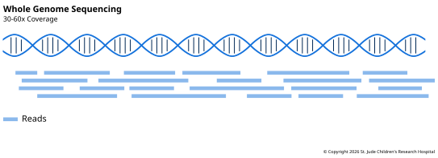

**Whole-genome sequencing** (WGS) reads all of a sample's DNA: every chromosome, the
genes and everything between them, and the small genome inside the mitochondria. It's
the most complete way to look for variants, and the most expensive per sample. As
sequencing has become cheaper, it has become the default for more and more work.

## What It Measures

WGS measures the sequence itself, everywhere. That's useful because the parts that code
for proteins are a small share of the genome: about 1%, or roughly 30 million bases ([Ng
et al., 2009][ng2009]). The rest holds promoters, enhancers, introns and long stretches
of repeats, and variants there can affect health too.

## How the Library Is Made

A genome library is the simplest kind: break the DNA, add adapters, sequence. There is
no step that picks out some fragments and throws away the rest. When there is enough
DNA, labs often skip PCR as well, which removes duplicates and evens out coverage (see
[Making Copies](../02-library-preparation.md#making-copies)).

## Depth and Read Setup

Most genomes are sequenced as 2 × 150 paired-end reads. Around 30x is the common depth
for finding inherited variants. Cancer studies sequence a tumor alongside a matched
normal sample, and often sequence the tumor deeper, because a somatic variant may be in
only some of its reads. In one large pan-cancer study, normal samples averaged 39x,
while tumors were sequenced to around 38x or 60x ([ICGC/TCGA Pan-Cancer Analysis of
Whole Genomes Consortium, 2020][pcawg]).

At 30x, one genome is about 90 billion bases of sequence, before quality scores.

## Tradeoffs

#### Pros

- **Every kind of variant.** Because every part of the genome is read, WGS can find
  every kind of variant in [Genomic
  Variation](../../03-genomic-variation/00-introduction.md): SNVs and indels in and out
  of genes, structural variants from read pairs and reads that cross breakpoints, and
  copy number changes from depth.
- **Even coverage.** Coverage is even across the genome, so changes in [read
  depth](../../03-genomic-variation/05-copy-number-variation.md#read-depth) are easier
  to trust than in assays that select fragments.

#### Cons

- **Cost.** A genome costs more per sample than an exome, because it takes far more
  sequencing to reach the same depth. In a review of clinical studies, a single genome
  test cost $1,906 to $24,810, against $555 to $5,169 for an exome ([Schwarze et al.,
  2018][schwarze]). Newer sequencers are bringing that down sharply: Ultima Genomics
  claims its sequencer can read a genome for about $80 ([Ultima Genomics,
  2025][ultima]). The data cost more to store and analyze, too.
- **Time.** Sequencing takes a while. On Illumina's NovaSeq X, a 2 × 150 run takes about
  22 to 48 hours, depending on the size of the flow cell, and the largest holds about 64
  genomes at 30x ([Illumina][novaseqx]). Making the library comes before that, and
  analyzing the data comes after.
- **Low-fraction variants.** Depending on the sequencing depth, a variant present in a
  small share of cells can be easy to miss. You can always sequence deeper to find more
  of them, but that drives up the cost. A deeper assay over a smaller region can also be
  added, such as a targeted panel to validate variants, or an exome as a second source
  of data for coding variants.

## Example: Diagnosing Rare Disease

The 100,000 Genomes Project, run by Genomics England, sequenced the genomes of people
with suspected rare genetic diseases in England's National Health Service. Its pilot
study enrolled 4,660 people: 2,183 patients and 2,477 of their family members ([Smedley
et al., 2021][smedley]). Sequencing a patient's parents too shows which variants each
inherited and which are new.

The project found a genetic diagnosis for 25% of the patients. Some of those answers
needed the whole genome: they were noncoding variants, structural variants, variants in
the mitochondrial genome, or coding variants in places an exome covers poorly.

[ng2009]: https://doi.org/10.1038/nature08250
[pcawg]: https://doi.org/10.1038/s41586-020-1969-6
[novaseqx]: https://www.illumina.com/systems/sequencing-platforms/novaseq-x-plus/specifications.html
[ultima]: https://finance.yahoo.com/news/ultima-genomics-increases-output-over-120000869.html
[schwarze]: https://doi.org/10.1038/gim.2017.247
[smedley]: https://doi.org/10.1056/NEJMoa2035790
