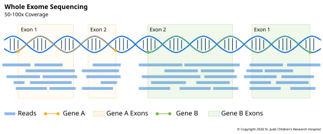

**Whole-exome sequencing** (WES) reads only the **exome**, the
[exons](../../01-biological-foundations/03-transcription.md#genomic-regions-and-transcription)
of all known genes. That's a small slice of the genome, but it holds most of the
variants known to cause disease by changing a protein, so for many questions it gives
most of the answer for much less sequencing.

## What It Measures

WES measures the sequence of protein-coding exons, about 1% of the genome ([Ng et al.,
2009][ng2009]). Commercial exome kits differ in exactly which exons they include, and
most also cover some of the untranslated regions at each end of a gene.

## How the Library Is Made

An exome library starts like a genome library, then adds a step called hybrid capture to
keep only the exons. The library is mixed with short strands of RNA or DNA, called
baits, that match the exons. Each bait carries a chemical tag, biotin, that sticks
tightly to magnetic beads. Fragments from exons pair with the baits, the beads pull them
out, and everything else is washed away ([Gnirke et al., 2009][gnirke]). The original
paper described it as using baits to "fish" targets out of a "pond" of DNA fragments.

Capture isn't perfect. Some fragments that don't match any bait come along anyway, so a
share of reads land off target. Regions very rich in G and C capture poorly, leaving
gaps in coverage ([Sulonen et al., 2011][sulonen]).

## Depth and Read Setup

Because the exome is so much smaller than the genome, the same number of reads covers it
far more deeply than it would cover the whole genome. Exomes are usually sequenced
paired-end. The first exome studies used around 40x ([Ng et al., 2010][ng2010]).
Clinical exomes go deeper: one clinical laboratory reported a mean of more than 130x
([Yang et al., 2013][yang]). Coverage is less even than in a genome, so a high average
still leaves some exons thinly covered.

## Tradeoffs

#### Pros

- **Coding variants.** WES is good at finding SNVs and small indels in coding regions,
  which is where most disease-causing variants known today are.
- **Depth.** Because the exome is small, the same number of reads covers it far more
  deeply than a genome (see [Depth and Read Setup](#depth-and-read-setup)).

#### Cons

It misses what it doesn't capture:

- **Noncoding variants.** Variants in promoters, enhancers and deep in introns aren't
  read at all.
- **Most structural variants.** Their breakpoints usually fall outside exons, where
  there are no reads.
- **Copy number changes, mostly.** Depth can still hint at large gains and losses, but
  capture adds its own unevenness, so the signal is noisier than in a genome.
- **Poorly captured exons.** Some exons, often those rich in G and C, get too few reads
  to call variants.

## Example: The First Gene Found by Exome

Miller syndrome is a rare disorder that affects the face and limbs. In 2009, its cause
was unknown. Researchers sequenced the exomes of four affected people from three
families, to a mean depth of 40x ([Ng et al., 2010][ng2010]). They removed variants
already listed in public databases, then looked for a gene with two new variants in
every patient, as expected for a recessive disease. Only one gene fit: *DHODH*, which
makes an enzyme cells need to build some of the bases in DNA and RNA. Sanger sequencing
found *DHODH* variants in three more families.

The authors described it as the first time exome sequencing had found the gene behind a
rare inherited disease with an unknown cause ([Ng et al., 2010][ng2010]). Within a few
years, exomes were being used in clinics. In one clinical laboratory's first 250
patients, exome sequencing found a likely genetic cause in 25% ([Yang et al.,
2013][yang]).

[ng2009]: https://doi.org/10.1038/nature08250
[gnirke]: https://doi.org/10.1038/nbt.1523
[sulonen]: https://doi.org/10.1186/gb-2011-12-9-r94
[yang]: https://doi.org/10.1056/NEJMoa1306555
[ng2010]: https://doi.org/10.1038/ng.499
