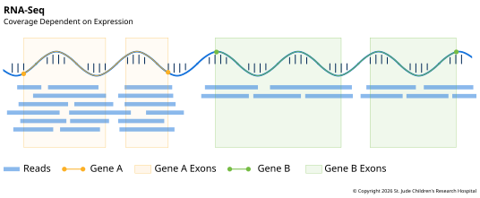

**RNA-seq** reads the RNA in a sample instead of the DNA. The genome is nearly the same
in every cell of the body, but the RNA isn't: it shows which genes a cell is using, and
how much, at the moment the sample was taken. RNA-seq is the most common way to measure
[gene
expression](../../01-biological-foundations/02-the-central-dogma.md#from-dna-to-protein),
and it can also find gene fusions, splicing changes and variants in expressed genes.

## What It Measures

RNA-seq measures how many copies of each RNA were in the sample, along with their
sequence. Since most reads come from [mature
mRNA](../../01-biological-foundations/03-transcription.md#genomic-regions-and-transcription),
most fall on exons, and many cross from one exon to the next, which shows how the gene
was [spliced](../../01-biological-foundations/03-transcription.md#alternative-splicing).

The result is always relative. More reads from a gene means more of its RNA compared
with the rest of the sample, and the same gene can look very different in another
tissue, at another time, or in a sample whose RNA started breaking down before it was
frozen or fixed as [FFPE](../01-samples-and-extraction.md#keeping-dna-and-rna-intact).

:::info A Proxy for Protein

RNA-seq is often used to learn which proteins a cell is making, but it measures RNA, and
the two only loosely agree. In mammalian cells, mRNA levels explain only about 30 to 40%
of the differences in protein levels between genes. The rest depends on how quickly each
mRNA is translated and how long each protein lasts ([Vogel and Marcotte, 2012][vogel]).
That said, RNA-seq is still a useful tool because it measures thousands of genes at
once, and whether a gene's mRNA is present is generally a good sign of whether its
protein is too ([Vogel and Marcotte, 2012][vogel]). It's the amounts that need care.
Measuring proteins directly takes
[proteomics](../../01-biological-foundations/05-protein-folding-and-modification.md).

:::

## How the Library Is Made

Most of a cell's RNA isn't mRNA. Ribosomal RNA, part of the machinery that makes
proteins, is typically more than 95% of the total ([Kukurba and Montgomery,
2015][kukurba]). Sequencing it would waste nearly every read, so it's removed first, in
one of two ways:

- **Poly-A selection** keeps only RNA with a [poly-A
  tail](../../01-biological-foundations/03-transcription.md#genomic-regions-and-transcription),
  which most mRNAs have, by catching the tail on beads coated with strands of Ts. What's
  left is mostly mRNA from protein-coding genes, so this is often called mRNA-seq. RNAs
  without a tail are lost, such as the mRNAs for histones, circular RNAs and some long
  noncoding RNAs ([Zhao et al., 2014][zhao]). Many long noncoding RNAs do have a tail,
  though, and are kept ([Derrien et al., 2012][derrien]).
- **Ribosomal RNA depletion** removes ribosomal RNA and keeps everything else, so it's
  often called **total RNA-seq**. Along with mRNA, it keeps noncoding RNAs with or
  without a tail, circular RNAs, and RNA that hasn't been spliced yet, so some reads
  fall in introns ([Zhao et al., 2014][zhao]). It also works better on partly broken
  RNA, such as RNA from FFPE samples, where the tail may be cut off from the rest of the
  molecule.

Poly-A selection has long been the usual choice ([Zhao et al., 2014][zhao]), and it
still uses reads more efficiently for protein-coding genes. In one comparison, 69% of
bases from poly-A libraries fell on known transcripts, against 20 to 30% from ribosomal
RNA depletion, where many reads fell in introns ([Zhao et al., 2014][zhao]). Ribosomal
RNA depletion has become a popular alternative ([Boone et al., 2018][boone]). Besides
handling FFPE samples, it's the better choice for measuring [noncoding
RNAs](../../07-advanced-topics/non-coding-rnas.md) ([Kukurba and Montgomery,
2015][kukurba]), and more studies want them as their roles come to light. Very small
RNAs, such as microRNAs, are usually sequenced with a separate method ([Kukurba and
Montgomery, 2015][kukurba]).

The remaining RNA is copied into cDNA by reverse transcriptase, and the cDNA is made
into a library like any other (see [Library Preparation](../02-library-preparation.md)).

## Depth and Read Setup

RNA-seq depth is counted in reads. A fold depth such as "30x" wouldn't mean much,
because each gene's coverage depends on how much it's expressed. ENCODE, a large project
that set standards for many of these assays, asks for at least 30 million aligned reads
or read pairs per sample ([ENCODE][encode-rna]). Reads are often paired-end, which helps
with splicing and fusions. Finding rarely expressed genes or rare splice forms takes
more reads.

## Tradeoffs

#### Pros

RNA-seq finds things DNA sequencing can't, or finds them more easily:

- **Expression.** Which genes are on, which are off, and how that changes with disease
  or treatment.
- **Fusions.** A [gene
  fusion](../../03-genomic-variation/04-structural-variation.md#finding-fusions) makes
  RNA that starts in one gene and ends in another, and reads that span the join reveal
  it directly, even when the DNA breakpoint is buried deep in an intron.
- **Splicing.** Reads that cross from one exon to another show which exons were joined,
  including unusual joins caused by variants.
- **Expressed variants.** A variant in an expressed gene shows up in its reads, and the
  share of reads carrying it shows whether one copy is expressed more than the other.

#### Cons

- **Genes that aren't expressed.** A variant in a gene that's switched off in the
  sampled tissue is invisible.
- **Whole transcripts.** Short reads see pieces of each RNA, so which complete version a
  gene made has to be inferred. [Long reads](../04-long-read-sequencing.md) can read the
  whole molecule.
- **Degraded samples.** RNA breaks down quickly, so careful sample handling is even more
  important than for DNA (see [Extraction and Quality
  Checks](../01-samples-and-extraction.md#extraction-and-quality-checks)).

## Example: Ph-like Leukemia

Some children and adults with acute lymphoblastic leukemia have cancer cells whose gene
expression looks like that of leukemias driven by
[BCR-ABL1](../../03-genomic-variation/04-structural-variation.md#bcr-abl1), but which
don't carry BCR-ABL1. This group, called Ph-like ALL, has a poor outcome. A 2014 study
looked closely at 154 patients with Ph-like ALL, most of them with RNA-seq ([Roberts et
al., 2014][roberts]). RNA-seq alone found rearranged genes in 116 of the 136 patients it
was used on.

Across all the methods, 91% of patients had a change that switched on a kinase, a
protein that sends signals telling the cell to grow. Many were fusions, involving a
short list of genes, including *ABL1*, *ABL2*, *JAK2* and *PDGFRB*. In lab tests,
leukemia cells with these changes responded to drugs that were already approved and that
block the kinase each change had switched on. The authors called for clinical trials to
test whether adding these drugs to treatment helps patients.

[vogel]: https://doi.org/10.1038/nrg3185
[zhao]: https://doi.org/10.1186/1471-2164-15-419
[derrien]: https://doi.org/10.1101/gr.132159.111
[boone]: https://doi.org/10.1093/nar/gky167
[kukurba]: https://doi.org/10.1101/pdb.top084970
[encode-rna]: https://www.encodeproject.org/documents/cede0cbe-d324-4ce7-ace4-f0c3eddf5972/
[roberts]: https://doi.org/10.1056/NEJMoa1403088
