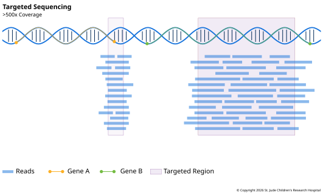

**Targeted sequencing** reads a chosen set of regions, usually a list of genes called a
**panel**. A panel can be a handful of genes or several hundred. Reading so little of
the genome makes it cheap and fast to read each region very deeply, which is why panels
are widely used in cancer testing.

## What It Measures

A panel measures the sequence of whatever its designers chose to include: often the
exons of genes known to play a role in a disease, and sometimes selected introns or
other regions where important variants are known to fall.

## How the Library Is Made

There are two main ways to pick out the targets ([Jennings et al., 2017][jennings]):

- **Hybrid capture.** It works like an
  [exome](02-whole-exome-sequencing.md#how-the-library-is-made), with baits for just the
  panel's regions.
- **Amplicon sequencing.** It skips the baits. Pairs of PCR primers copy each target
  region directly, so the library is made only of those regions. It's fast and works
  with very little DNA. But a variant under a primer can stop that copy from being
  amplified, and the method can't see anything outside its primers.

## Depth and Read Setup

Panels are read to hundreds or thousands of x. Depth is the point: in a tumor sample
that's mostly normal cells, a variant may be in only a few percent of reads. Guidelines
for cancer panels note that an average of at least 1,000x may be needed to find variants
in samples with few tumor cells ([Jennings et al., 2017][jennings]).

Some tests go further still. In a [liquid
biopsy](../01-samples-and-extraction.md#kinds-of-samples), DNA from the tumor can be a
tiny share of the cell-free DNA in the blood. At that level, real variants are rarer
than sequencing and PCR errors, so these tests attach
[UMIs](../02-library-preparation.md#making-copies) to each molecule before copying and
only trust variants seen across many copies of the same original molecule.

## Tradeoffs

#### Pros

- **Low-fraction variants.** A panel finds SNVs and small indels in its genes with high
  confidence, even at low fractions.
- **Some larger changes.** Depending on its design, it can also find some copy number
  changes and fusions.
- **Speed.** The data is small and the results are fast.
- **Easier interpretation.** Every gene on the panel was chosen for a reason, so results
  are easier to interpret than a genome's.

#### Cons

- **Only what's on the panel.** A variant in a gene that wasn't included is invisible,
  and a new panel has to be designed and validated before anything can be added.
- **No room for discovery.** Because only known genes are read, panel data can't turn up
  new ones. Nor can it be searched later for genes it left out. When a gene is newly
  linked to a disease, an exome or genome from the same patient can be reanalyzed, but
  with a panel, the sample has to be sequenced again.

## Example: Sequencing Ten Thousand Tumors

At Memorial Sloan Kettering Cancer Center, a panel called MSK-IMPACT was offered to
patients with advanced cancer as part of their care. A 2017 report covered 10,945 tumors
from 10,336 patients, sequenced to a mean depth of 718x ([Zehir et al., 2017][zehir]).
The panel, first 341 and then 410 genes, used hybrid capture to read every
protein-coding exon of its genes, plus selected introns of 17 genes that are often
rearranged in cancer. In 98% of cases, the tumor was sequenced alongside a blood sample
from the same patient, so inherited variants could be set aside.

About 37% of patients had at least one change that pointed to a possible targeted
treatment. Among the first 5,009 patients tested, 11% went on to join a clinical trial
of a drug aimed at a change found in their tumor.

[jennings]: https://doi.org/10.1016/j.jmoldx.2017.01.011
[zehir]: https://doi.org/10.1038/nm.4333
