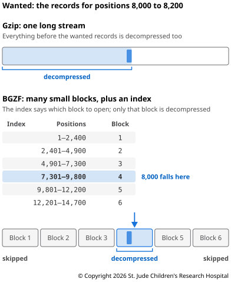
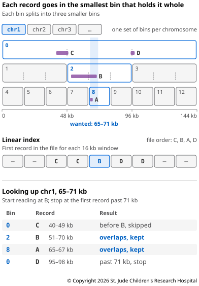

Genomic files are large, so they are almost always stored compressed. Most are
compressed with gzip, or with BGZF, a form of gzip built for genomics. This page
explains how compression works, why plain gzip makes it slow to look something up, and
how BGZF and its index files solve that.

## How Compression Works

Text files repeat themselves. In a VCF, neighboring lines usually start with the same
chromosome name, and the same few words fill the columns again and again. Gzip uses a
method called **DEFLATE**, which looks for text that already appeared shortly before and
replaces it with a short note: go back this many bytes and copy this many. It also
writes common characters with fewer bits than rare ones ([RFC
1951](https://www.rfc-editor.org/rfc/rfc1951)). Nothing is lost — decompressing gives
back exactly the original bytes.

A note can only point back 32 KB (32,768 bytes), so only repeats that sit close together
help. That's why sorting shrank the BAM file in [Preparing
Alignments](../05-from-reads-to-variants/03-preparing-alignments.md) — once overlapping
reads sit next to each other, their shared bases are close enough to be found.

The catch is that each note depends on the text before it. To read a few lines from the
middle of a gzip file, a program has to decompress everything before them, starting from
the very beginning. In a large file, that can mean gigabytes of work to read a few
lines.

## BGZF: Compressing in Blocks

**BGZF** gets around this by compressing a file in pieces. It cuts the text into blocks
of at most 64 KiB (65,536 bytes), compresses each block on its own as a complete small
gzip file, and joins the results end to end (section 4.1 of the [SAM
specification](https://samtools.github.io/hts-specs/SAMv1.pdf)). Each block starts
fresh, with nothing earlier to point back to, so a program can jump to any block and
decompress just that one.

A few details are worth knowing in practice:

- **`gunzip` can read BGZF.** The gzip format allows a file to be several compressed
  pieces joined together ([RFC 1952](https://www.rfc-editor.org/rfc/rfc1952)), so
  `gunzip` reads a BGZF file from start to end. The reverse isn't true; a plain gzip
  file lacks the block layout BGZF adds, so tools that need BGZF refuse it.
- **It costs little space.** Starting each block over loses a little of the repetition
  gzip could use, but in the Try It below, the two come out within a few percent of each
  other.
- **It marks the end.** A BGZF file should end with a small empty block. If that block
  is missing, the file may have been cut short, for example by an interrupted download,
  and tools such as `samtools` and `bcftools` warn about it.

BGZF was designed for BAM files ([Li et al.,
2009](https://doi.org/10.1093/bioinformatics/btp352)), and every BAM file is
BGZF-compressed. BCF, the binary form of VCF, is normally BGZF-compressed too ([VCF
specification](https://samtools.github.io/hts-specs/VCFv4.5.pdf)), although `bcftools`
can also write it uncompressed, as it did between commands in Chapter 5. `tabix` later
extended it to any tab-delimited file sorted by position, such as VCF, BED and GFF ([Li,
2011](https://doi.org/10.1093/bioinformatics/btq671)). You've already made BGZF files:
in Chapter 5, `-Oz` told `bcftools` to write compressed VCF, which it writes as BGZF.
Some tools write BGZF even where nothing needs an index; `samtools fastq` does, so the
reads on [FASTQ Files](02-FASTQ-files.md) are BGZF too.

A file's name won't tell you which kind it is; gzip and BGZF files both usually end in
`.gz`. The `htsfile` tool reads the file itself and reports which it is.

## Indexes

Blocks alone aren't enough. A program also needs to know which block holds the records
it wants. That's the job of an **index**, a small separate file that maps stretches of
the genome to the places in the compressed file where their records may be. It doesn't
list every record, just where each stretch begins and ends, so it stays small (Figure
6.1).



Each place in an index is a **virtual offset**, made of two numbers: where a block
starts in the compressed file, and how far into that block, once it's decompressed, the
first record begins. A program jumps straight to the block, decompresses it, and skips
ahead to the record. The index is only a guide — the program may decompress a few more
blocks than it needs, and it checks each record, discarding any that fall outside the
stretch it asked for.

An index only works on a file sorted by position, because it can only point to where a
stretch's records start if they all sit together. That's why `tabix` and `samtools
index` need sorted input ([tabix manual](https://www.htslib.org/doc/tabix.html)). You'll
meet three kinds of index:

- **`.bai`** for BAM files, made by `samtools index`.
- **`.tbi`** for BGZF-compressed tab-delimited files such as VCF, BED and GFF, made by
  `tabix` or `bcftools index -t`.
- **`.csi`**, a newer format that works for both. `.bai` and `.tbi` can't handle
  positions past 2<sup>29</sup>, about 537 million bases, so the very long chromosomes
  in some plant and animal genomes need `.csi` ([samtools index
  manual](https://www.htslib.org/doc/samtools-index.html)).

How does an index know which records belong to a stretch? `.bai` and `.tbi` indexes sort
records into **bins**, windows of the genome nested inside each other. One bin covers a
whole chromosome, up to about 537 million bases; it splits into eight smaller bins, and
each of those splits into eight again, down to bins of 16,384 bases (section 5.1 of the
[SAM specification](https://samtools.github.io/hts-specs/SAMv1.pdf)). Each record goes
in the smallest bin that holds it whole, and for each bin, the index lists where that
bin's records are in the file. Every chromosome gets its own set of bins. To look up a
stretch, a tool checks every bin on that chromosome that overlaps it, at every level,
then discards the records that fall outside it (Figure 6.2).



A record that crosses the boundary between two large bins, like record C, lands in a
large bin, so many lookups check it. To avoid that, `.bai` and `.tbi` indexes keep a
second table — the **linear index**, which lists, for each window of 16,384 bases, the
earliest place in the file where a record overlapping that window starts. When looking
up a stretch, a tool skips anything in the file before the place listed for the window
where the stretch begins, as it does with record C in Figure 6.2. On the other side,
because the file is sorted, the tool stops at the first record that starts past the
stretch, such as record D.

An index sits next to its file, with the same name plus its own ending, such as
`hg002.bam` and `hg002.bam.bai`. Without it, a program can still read the whole file
from start to end, but it can't look up a stretch. An index also lets tools fetch part
of a file over the internet. In [Download the
Reads](../05-from-reads-to-variants/01-setting-up.md#download-the-reads), `samtools`
used the index to download only the parts of the BAM file that could hold reads in the
region, rather than the whole file.

## Try It

This uses the files from Chapter 5's exercise; if you haven't done it, start at [Setting
Up](../05-from-reads-to-variants/01-setting-up.md). Go back to that folder and turn the
environment on:

```bash
# Move into the exercise folder
cd reads-to-variants
# Turn on the environment with the tools
conda activate reads-to-variants
```

`bgzip`, `tabix` and `htsfile` come with HTSlib, which was installed along with
`samtools` and `bcftools`. Start by asking `htsfile` what two of your files are:

```bash
# Report the format and compression of each file
htsfile hg002.calls.vcf.gz hg002.bam
```

It reports the VCF as `BGZF-compressed` and the BAM as `compressed sequence data`, which
for BAM always means BGZF. Because BGZF is valid gzip, `gunzip` can read it too:

```bash
# Decompress the calls and count the lines that aren't header
gunzip -c hg002.calls.vcf.gz | grep -vc "^#"
```

`-c` writes the result to the screen instead of replacing the file. This prints 1,800,
one line per call.

Next, make a plain-text copy of the calls and compress it both ways:

```bash
# Write a plain-text copy of the calls
gunzip -c hg002.calls.vcf.gz > calls.vcf
# Compress it with gzip
gzip -c calls.vcf > calls.gzip.vcf.gz
# Compress it with bgzip
bgzip -c calls.vcf > calls.bgzf.vcf.gz
# Compare the sizes
ls -l calls.*
```

The plain text is about 345 KB. Both compressed copies are under a quarter of that:
about 79 KB with gzip and 77 KB with bgzip. Their names end the same way, but `htsfile`
tells them apart:

```bash
# Check how each copy is compressed
htsfile calls.gzip.vcf.gz calls.bgzf.vcf.gz
```

Now try to index both:

```bash
# Try to index the gzip copy
tabix -p vcf calls.gzip.vcf.gz
# Index the BGZF copy
tabix -p vcf calls.bgzf.vcf.gz
```

`-p vcf` tells `tabix` the file is a VCF. The first command fails with `the compression
of 'calls.gzip.vcf.gz' is not BGZF`, and the second writes `calls.bgzf.vcf.gz.tbi`. If
you get that error with your own files, decompress them and compress them again with
`bgzip`, as you did above.

With an index, you can look up one stretch of the genome:

```bash
# Count the calls in a stretch of 100,000 bases
tabix calls.bgzf.vcf.gz chr20:10500000-10600000 | wc -l
# Count the reads in the same stretch
samtools view -c hg002.bam chr20:10500000-10600000
```

There are 168 calls and 41,393 reads. Each tool used its index to skip most of the file.
When you're done, delete the copies:

```bash
# Delete the copies and index made on this page
rm calls.vcf calls.gzip.vcf.gz calls.bgzf.vcf.gz calls.bgzf.vcf.gz.tbi
```

Next, the files that sequencing produces — [FASTQ Files](02-FASTQ-files.md).
